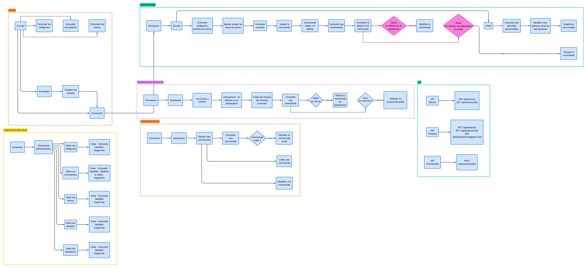
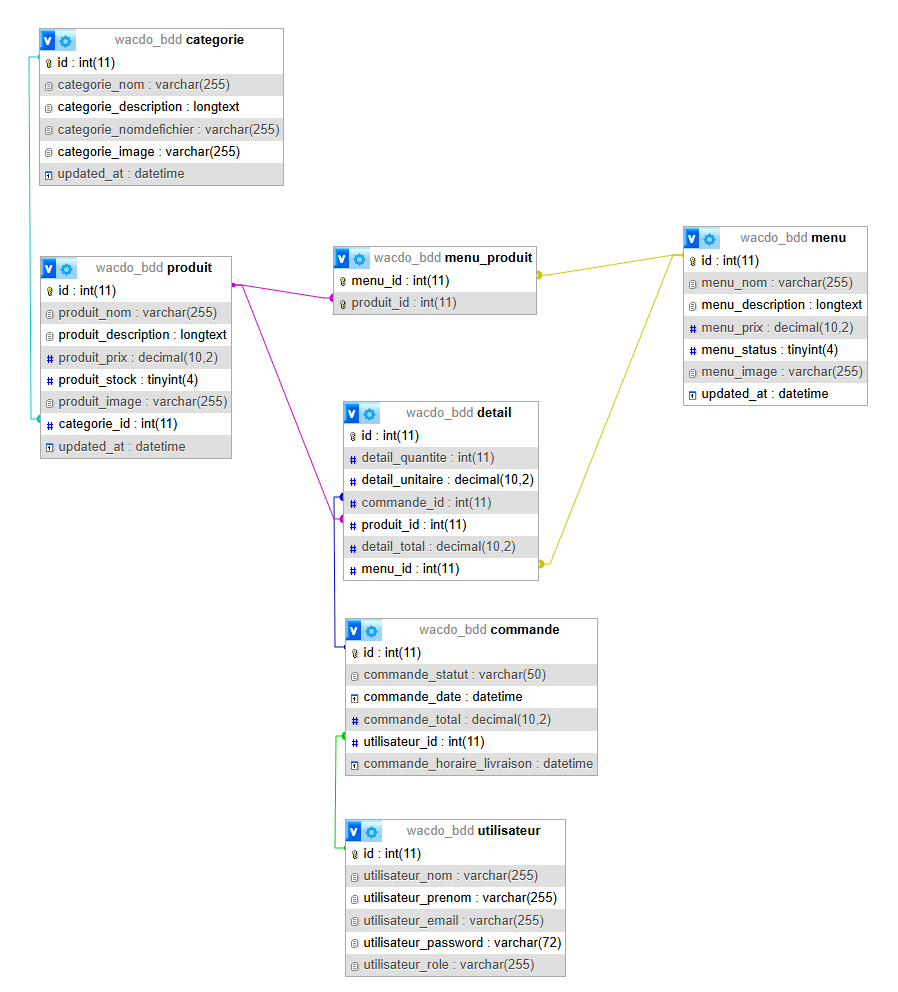

# Wacdo

Wacdo est une application Web de restauration développée dans le cadre du projet de la formation Développeur Web fullstuck option ux/ui design pour le module back-end.

L'application permet aux clients de consulter les catégories, produits et menus proposés, de créer un compte, de gérer un panier et de passer des commandes.

Une interface d'administration sous forme de dashboard, permet également de gérer les données de l'application et le traitement des commandes selon plusieurs rôles .

---

## Sommaire

- [Présentation du projet](#présentation-du-projet)
- [Technologies utilisées](#technologies-utilisées)
- [Architecture du projet](#architecture-du-projet)
- [Fonctionnalités](#fonctionnalités)
- [Rôles utilisateurs](#rôles-utilisateurs)
- [Gestion des commandes](#gestion-des-commandes)
- [Sécurité](#sécurité)
- [Données personnelles](#données-personnelles)
- [API](#api)
- [Base de données](#base-de-données)
- [Schéma fonctionnel](#schéma-fonctionnel)
- [Modèle physique](#modèle-physique)
- [Installation](#installation)
- [Migrations](#migrations)
- [Fixtures](#fixtures)
- [Tests](#tests)
- [Structure du projet](#structure-du-projet)
- [Limites du projet](#limites-du-projet)

---

# Présentation du projet

Wacdo est une application permettant de gérer les commandes d'un restaurant.

Le projet comporte deux parties principales :

- un site web destiné aux clients .
- un back-office destiné aux employés et à l'administration.

Le site permet notamment de consulter les produits et menus, de créer un compte, de gérer un panier et de suivre ses commandes.

Le back-office permet de gérer :

- les catégories .
- les produits .
- les menus .
- les utilisateurs .
- les commandes .
- les différents statuts des commandes.

Les fonctionnalités disponibles dans l'administration dépendent du rôle de l'utilisateur connecté.

---

# Technologies utilisées

Le projet utilise principalement :

| Technologie | Utilisation |
| --- | --- |
| PHP | Développement Back-end |
| Symfony 6.4 | Framework PHP |
| Doctrine ORM | Gestion des données et relations |
| MySQL / MariaDB | Base de données |
| Twig | Génération des vues |
| HTML | Structure des pages |
| CSS | Mise en forme |
| JavaScript | Interactions côté navigateur |
| Bootstrap | Composants et mise en page |
| VichUploaderBundle | Gestion de l'envoi des images |
| FOS CKEditor | Édition des descriptions |
| PHPUnit | Tests unitaires |
| Composer | Gestion des dépendances |
| Git / GitHub | Versionnement du projet |

Le projet a notamment été développé et testé localement avec PHP 8.2 et MariaDB sous XAMP.

---

# Architecture du projet

Wacdo utilise l'architecture MVC proposée par Symfony.

## Modèle

Les données sont représentées par les entités Doctrine situées dans :

```text
src/Entity/
```

Les principales entités sont :

```text
Categorie
Produit
Menu
Commande
Detail
Utilisateur
```

Les repositories permettant d'effectuer les requêtes sont situés dans :

```text
src/Repository/
```

## Vue

Les pages HTML sont générées avec Twig.

Les fichiers se trouvent dans :

```text
templates/
```

Les vues sont séparées entre le site client et le back-office.

## Contrôleur

Les contrôleurs sont situés dans :

```text
src/Controller/
```

Ils permettent notamment :

- de recevoir les requêtes HTTP .
- d'utiliser les repositories .
- de préparer les données .
- de traiter les formulaires .
- de contrôler les droits d'accès .
- de retourner les vues Twig ou les réponses JSON de l'API.

---

# Fonctionnalités

## Site client

Un visiteur peut :

- consulter l'accueil .
- consulter les catégories .
- consulter les produits .
- consulter les menus .
- créer un compte .
- se connecter.

Un utilisateur connecté peut également :

- ajouter des produits au panier .
- ajouter des menus au panier .
- modifier les quantités du panier .
- passer une commande .
- consulter ses commandes .
- consulter le détail d'une commande .
- modifier une commande lorsque son statut le permet .
- annuler une commande lorsque son statut le permet .
- consulter son profil .
- modifier ses informations personnelles .
- modifier son mot de passe .
- supprimer son compte.

## Back-office

Le back-office permet selon les droits de l'utilisateur :

- de gérer les catégories .
- de gérer les produits .
- de gérer les menus .
- de gérer les utilisateurs .
- de gérer les commandes .
- de rechercher et filtrer les données .
- de suivre l'état de préparation des commandes.

---

# Rôles utilisateurs

Wacdo utilise plusieurs rôles.

## ROLE_ADMIN

L'administrateur possède les droits les plus élevés.

Il peut notamment :

- créer, consulter, modifier et supprimer les catégories .
- créer, consulter, modifier et supprimer les produits .
- créer, consulter, modifier et supprimer les menus .
- créer, consulter, modifier et supprimer les utilisateurs .
- gérer les commandes .
- modifier les statuts des commandes .
- supprimer une commande.

## ROLE_PREPARATEUR

Le préparateur travaille sur les commandes à préparer.

Il peut :

- consulter les commandes en attente .
- consulter les commandes en préparation .
- consulter le détail d'une commande .
- passer une commande de `en attente` à `en préparation` .
- passer une commande de `en préparation` à `prête`.

Les commandes sont affichées par horaire de livraison croissant.

Le préparateur ne peut pas modifier ou supprimer directement une commande.

## ROLE_ACCUEIL

Le rôle Accueil correspond notamment aux équipiers travaillant au comptoir ou prenant les commandes.

Il peut :

- consulter les commandes .
- créer une commande .
- modifier une commande .
- déclarer une commande prête comme livrée.

Il ne peut pas supprimer une commande.

## ROLE_USER

Le rôle utilisateur correspond au client du site.

Il permet notamment :

- d'utiliser le panier .
- de passer une commande .
- de consulter ses propres commandes .
- de gérer son profil et ses données personnelles.

---

# Gestion des commandes

Une commande possède notamment :

```text
un numéro
une date de création
un horaire de livraison
un statut
un utilisateur éventuel
un ou plusieurs détails
un montant total
```

Les principaux statuts utilisés sont :

```text
en attente
en préparation
prête
livrée
annulée
```

L'entité accepte également le statut :

```text
en livraison
```

Le parcours principal de préparation est :

```text
en attente
    ↓
en préparation
    ↓
prête
    ↓
livrée
```

Dans le projet, le statut `prête` correspond à une commande dont la préparation est terminée et qui peut être remise au client.

Les commandes destinées au préparateur sont triées selon :

```text
commande_horaire_livraison ASC
```

Une commande nouvellement créée reçoit par défaut un horaire de livraison prévu 30 minutes après sa création lorsqu'aucune autre valeur n'est définie.

---

# Sécurité

L'application utilise le composant Security de Symfony.

Les principales protections mises en place sont :

- authentification par adresse email et mot de passe .
- mots de passe hachés avec bcrypt .
- sessions Symfony .
- protection CSRF sur les formulaires et actions sensibles .
- contrôle des rôles .
- protection des routes d'administration .
- validation des données reçues par les formulaires .
- requêtes Doctrine avec paramètres .
- contrôle côté serveur des changements de statut des commandes .
- contrôle d'accès aux commandes appartenant aux clients.

Les routes du back-office sont protégées dans :

```text
config/packages/security.yaml
```

Les utilisateurs sont chargés depuis la base de données grâce à leur adresse email.

---

# Données personnelles

Un utilisateur peut consulter depuis son profil :

- son nom .
- son prénom .
- son adresse email .
- son rôle.

Il peut également :

- modifier son nom .
- modifier son prénom .
- modifier son adresse email .
- modifier son mot de passe .
- supprimer définitivement son compte.

Wacdo informe également l'utilisateur de l'utilisation de ses données personnelles.

Lorsqu'un compte utilisateur est supprimé, les commandes déjà enregistrées peuvent être conservées afin de conserver l'historique des commandes.

La relation Doctrine utilise :

```text
ON DELETE SET NULL
```

La commande n'est donc plus associée au compte supprimé.

---

# API

Wacdo possède une API permettant de communiquer avec un Front-end.

Les réponses sont retournées au format JSON.

## Menus

Liste des menus disponibles :

```http
GET /api/menus
```

Détail d'un menu :

```http
GET /api/menus/{id}
```

## Produits

Liste des produits :

```http
GET /api/produits
```

Détail d'un produit :

```http
GET /api/produits/{id}
```

Filtrer les produits par catégorie :

```http
GET /api/produits?categorie={id}
```

## Commandes

Créer une commande :

```http
POST /api/commandes
Content-Type: application/json
```

Exemple de contenu JSON :

```json
{
    "details": [
        {
            "type": "produit",
            "id": 1,
            "quantite": 2
        },
        {
            "type": "menu",
            "id": 1,
            "quantite": 1
        }
    ]
}
```

L'API vérifie notamment :

- le format JSON .
- le type d'article .
- l'identifiant de l'article .
- la quantité .
- la disponibilité du produit .
- la disponibilité du menu.

Le prix d'un article n'est pas envoyé directement par le client.

Le serveur récupère les prix présents dans la base de données et calcule lui-même le montant total de la commande.

---

# Base de données

Wacdo utilise Doctrine ORM pour faire le lien entre les objets PHP et la base de données relationnelle.

Les principales tables sont :

```text
categorie
produit
menu
menu_produit
detail
commande
utilisateur
```

Des tables techniques utilisées par Symfony et Doctrine sont également présentes, par exemple :

```text
doctrine_migration_versions
messenger_messages
```

## Relations principales

Les principales relations sont :

```text
Categorie OneToMany Produit
Produit ManyToOne Categorie

Produit ManyToMany Menu
Menu ManyToMany Produit

Commande OneToMany Detail
Detail ManyToOne Commande

Produit OneToMany Detail
Detail ManyToOne Produit

Menu OneToMany Detail
Detail ManyToOne Menu

Utilisateur OneToMany Commande
Commande ManyToOne Utilisateur
```

La relation `ManyToMany` entre `Menu` et `Produit` entraîne la création d'une table de liaison :

```text
menu_produit
```

Cette table contient notamment :

```text
menu_id
produit_id
```

## Schéma de données

Le schéma suivant présente les différentes entités, leurs attributs, les clés et les principales relations de la base de données.

[](./assets/bdd%20Wacdo/base%20de%20donnes%20Wacdo.png)

---

# Schéma fonctionnel

Le schéma fonctionnel présente les principaux parcours de l'application selon les différents utilisateurs :

```text
Visiteur
Client
Administrateur
Préparateur
Accueil
API
```

Il permet notamment de visualiser les fonctionnalités accessibles selon chaque rôle et les principales étapes du traitement d'une commande.

[](./docs/schemas/schema-fonctionnel-wacdo.png)

---

# Modèle physique

Le modèle physique correspond à la structure réellement créée dans MariaDB.

Il permet de visualiser :

- les tables .
- les colonnes .
- les types SQL .
- les clés primaires .
- les clés étrangères .
- les relations entre les tables.

Le modèle physique a été récupéré depuis la vue **Concepteur** de phpMyAdmin.

[](./docs/schemas/modele-physique-wacdo.png)

La table `menu_produit` visible dans ce modèle correspond à la table de liaison générée pour la relation `ManyToMany` entre les entités `Menu` et `Produit`.

---

# Exemple de requête SQL

La requête suivante permet de récupérer les commandes qui doivent encore être préparées et de les trier selon l'horaire de livraison prévu :

```sql
SELECT
    id,
    commande_statut,
    commande_date,
    commande_horaire_livraison,
    commande_total
FROM commande
WHERE commande_statut IN ('en attente', 'en préparation')
ORDER BY commande_horaire_livraison ASC;
```

Cette requête utilise :

```text
SELECT
WHERE
IN
ORDER BY
ASC
```

Elle correspond notamment au besoin du rôle Préparateur qui doit consulter les commandes à préparer par horaire de livraison croissant.

---

# Installation

## Prérequis

Avant de lancer le projet, il est nécessaire d'avoir :

- PHP 8.1 minimum .
- Composer .
- MySQL ou MariaDB .
- un serveur Web local comme XAMPP .
- Git.

Le projet utilise Symfony 6.4.

## Récupération du projet

Cloner le dépôt :

```bash
git clone https://github.com/montblancsw-debug/WacdoSkill4all.git
```

Se placer dans le dossier :

```bash
cd WacdoSkill4all
```

Installer les dépendances :

```bash
composer install
```

---

# Configuration de la base de données

La configuration de Doctrine utilise la variable :

```text
DATABASE_URL
```

Pour un environnement local XAMPP avec MariaDB, il est recommandé d'utiliser un fichier :

```text
.env.local
```

Exemple :

```dotenv
APP_ENV=dev

DATABASE_URL="mysql://root:@127.0.0.1:3306/Wacdo_bdd?serverVersion=10.4.32-MariaDB&charset=utf8mb4"
```

Cette configuration doit être adaptée selon :

- le nom de la base .
- l'utilisateur MySQL .
- le mot de passe .
- la version de MySQL ou MariaDB.

---

# Création de la base de données

Créer la base avec Doctrine :

```bash
php bin/console doctrine:database:create
```

Puis appliquer les migrations :

```bash
php bin/console doctrine:migrations:migrate
```

Vérifier ensuite la cohérence entre les entités et la base :

```bash
php bin/console doctrine:schema:validate
```

---

# Migrations

Les migrations Doctrine sont situées dans :

```text
migrations/
```

Elles permettent de faire évoluer la structure de la base de données.

Les commandes déjà présentes dans la base reçoivent un horaire de livraison calculé à partir de leur date de création avant que la colonne soit rendue obligatoire.

---

# Fixtures

Les données de démonstration sont situées dans :

```text
src/DataFixtures/
```

Les Fixtures permettent de créer rapidement des données de test telles que :

- les catégories .
- les produits .
- les utilisateurs .
- les commandes .
- les détails de commandes.

Pour charger les Fixtures dans un environnement de développement :

```bash
php bin/console doctrine:fixtures:load
```

Attention : cette commande peut supprimer les données déjà présentes dans la base avant de charger les données de démonstration.

---

# Lancement du projet

Avec Symfony CLI :

```bash
symfony server:start
```

L'application peut ensuite être ouverte dans le navigateur à l'adresse indiquée par Symfony, par exemple :

```text
http://127.0.0.1:8000
```

Il est également possible d'utiliser Apache avec XAMPP selon la configuration locale.

---

# Tests

Le projet utilise PHPUnit.

Lancer tous les tests :

```bash
php bin/phpunit
```

Lors de la dernière validation du projet :

```text
13 tests
29 assertions
100 % réussis
```

Les tests vérifient notamment :

- les informations principales d'un produit .
- la relation entre Produit et Menu .
- l'ajout et le retrait d'un Detail dans une Commande .
- les règles de modification d'une commande .
- les règles d'annulation d'une commande .
- la relation entre Utilisateur et Commande .
- l'identifiant de connexion d'un utilisateur .
- les rôles utilisateurs.

Les tests se trouvent dans :

```text
tests/
```

Vérifier les templates Twig :

```bash
php bin/console lint:twig templates
```

Vérifier la base Doctrine :

```bash
php bin/console doctrine:schema:validate
```

Vider et reconstruire le cache Symfony :

```bash
php bin/console cache:clear
```

---

# Structure du projet

```text
Wacdo/
│
├── assets/
│   ├── bdd Wacdo/
│   └── styles/
│
├── config/
│   ├── packages/
│   └── routes/
│
├── docs/
│   └── schemas/
│       ├── modele-physique-wacdo.png
│       └── schema-fonctionnel-wacdo.png
│
├── migrations/
│
├── public/
│   ├── css/
│   ├── images/
│   │   ├── categories/
│   │   ├── menus/
│   │   └── produits/
│   └── js/
│
├── src/
│   ├── Controller/
│   ├── DataFixtures/
│   ├── Entity/
│   ├── Form/
│   ├── Repository/
│   ├── Security/
│   └── Service/
│
├── templates/
│   ├── admin_categorie/
│   ├── admin_commande/
│   ├── admin_dashboard/
│   ├── admin_menu/
│   ├── admin_produit/
│   ├── admin_utilisateur/
│   ├── front_categorie/
│   ├── front_commande/
│   ├── front_home/
│   ├── front_menu/
│   ├── front_panier/
│   ├── front_produit/
│   ├── profil/
│   ├── registration/
│   └── security/
│
├── tests/
│   ├── Controller/
│   └── Entity/
│
├── composer.json
├── phpunit.dist.xml
└── readme.md
```

---

# Gestion des images

Les images des catégories, produits et menus sont gérées avec VichUploaderBundle.

Les images sont enregistrées dans :

```text
public/images/categories/
public/images/produits/
public/images/menus/
```

Les entités utilisent également une propriété temporaire `imageFile` pour recevoir les fichiers envoyés depuis les formulaires.


# Recherche, filtres et tris

Le back-office utilise plusieurs recherches et filtres.

Exemples :

## Produits

Les produits peuvent être recherchés et filtrés selon :

- leur nom .
- leur disponibilité .
- leur catégorie.

## Menus

Les menus peuvent être recherchés et filtrés selon :

- leur nom .
- leur statut.

## Utilisateurs

Les utilisateurs peuvent être recherchés et filtrés selon :

- leur nom .
- leur email .
- leur rôle.

## Commandes

Les commandes peuvent être recherchées selon plusieurs informations.

Pour le rôle Préparateur, seules les commandes :

```text
en attente
en préparation
```

sont affichées.

Elles sont ensuite triées par :

```text
commande_horaire_livraison ASC
```

---

# Routes et contrôleurs

Symfony utilise les attributs PHP pour déclarer les routes.

Exemple :

```php
#[Route('/api/produits', name: 'app_api_produit_')]
```

Les routes permettent d'associer une URL à une méthode d'un contrôleur.

Les routes sont utilisées pour :

- afficher les pages .
- traiter les formulaires .
- modifier les données .
- sécuriser les actions .
- exposer les données JSON de l'API.

---

# Doctrine ORM

Doctrine permet de faire le lien entre les classes PHP et la base de données.

Exemple de relation :

```php
#[ORM\ManyToOne(inversedBy: 'commandes')]
#[ORM\JoinColumn(nullable: true, onDelete: 'SET NULL')]
private ?Utilisateur $utilisateur = null;
```

Doctrine permet notamment :

- de créer les relations entre les entités .
- d'utiliser les repositories .
- d'enregistrer des objets en base .
- de générer des migrations .
- de gérer les relations OneToMany, ManyToOne et ManyToMany.

---

## Paiement

Aucun système de paiement n'est intégré.

Les commandes sont identifiées par leur numéro.

## Données de démonstration

Les Fixtures sont uniquement destinées au développement et aux démonstrations.

## Stockage des images

Les images sont stockées localement sur le serveur Web.

Aucun service de stockage externe ou Cloud n'est utilisé.

---

# Documentation du projet

Les principaux documents du projet sont disponibles dans :

```text
docs/
```

Le dossier :

```text
docs/schemas/
```

contient notamment :

```text
schema-fonctionnel-wacdo.png
modele-physique-wacdo.png
```

Le schéma général de la base de données est actuellement disponible dans :

```text
assets/bdd Wacdo/base de donnes Wacdo.png
```

---